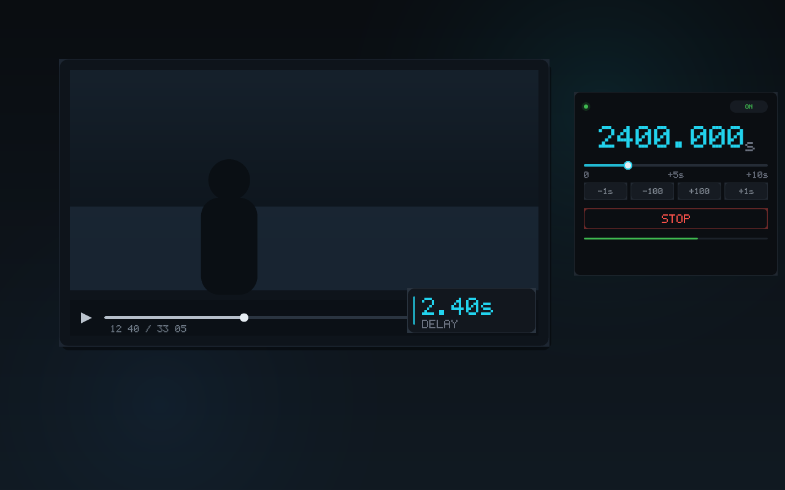

# 音画偏移 · 标签页音频

接管**当前标签页**的音频输出，做实时延迟，修正音画不同步。
页面自己的播放器、进度条、画质切换、字幕全部不动——它只是把最终输出的声音推迟一点。



<sub>播放器、工具栏面板、页面内悬浮面板三者同时工作；页面本身不受影响。</sub>

***

## 特性

- **零适配**：抓的是浏览器渲染后的最终混音，不受网站 CORS、播放器实现、加密流影响
- **一个界面**：点图标即接管，所有调节都在页面右下角那块面板里，没有第二个弹窗
- **实时可调**：拖滑块立刻生效，不用刷新、不用重新加载
- **全屏可用**：面板挂在页面里，切全屏也跟着走
- **记住上次**：延迟值存在本地，下次接管直接沿用
- **双向模式**：MSE 播放器上可以切换到「声音提前」，见下节
- **无网络请求**：所有代码打包在扩展内，可离线使用，不采集任何数据

***

## 为什么是扩展，不是油猴脚本

`chrome.tabCapture` 是扩展 API，页面上下文和油猴都拿不到。

***

## 安装

**方式一：源码加载**（推荐开发时用）

```bash
git clone https://gitee.com/the-chicken-god-comes/AudioDelaySync.git
```

1. 打开 `chrome://extensions`（Edge 是 `edge://extensions`）
2. 右上角打开**开发者模式**
3. 点**加载已解压的扩展程序**，选中仓库目录
4. 把图标固定到工具栏

**方式二：打包安装**

```bash
node tools/package.js   # 产出 dist/audio-delay-sync-<version>.zip
```

把 zip 解压后按方式一加载；或直接上传到 Edge 加载项商店 / Chrome 应用商店。

要求 Chromium 内核 **116+**（用到 `offscreen.hasDocument`）。

***

## 使用

1. 打开视频页面，**让它开始播放**（没有声音时捕获会失败）
2. **点一下工具栏上的扩展图标** —— 声音被接管，页面右下角出现面板
3. 拖滑块调节，口型和声音对上了就停手

再点一次图标就是停止，声音立刻回到页面。面板上也有「停止」按钮。

面板可以拖到任意位置，点 `−` 收起成一条，点 `×` 停止并关闭。

**滚轮调节**：鼠标停在面板上滚动即可。向上滚 = 数值变大（声音更晚），一格 100ms，`Shift` 一格 1 秒。滚轮只作用于面板，不会带着页面滚。

**键盘微调**：鼠标悬停在面板上时，`←` `→` 每次 100ms，`Shift + ←/→` 每次 1 秒，`Home` 归零。只在悬停时生效，避免和播放器自己的方向键（快进快退）打架。

**接管失败会弹提示**：比如标签页没有声音、或页面不允许捕获，顶部会出现一条红色说明，7 秒后自动消失。

***

## 原理

```
tabCapture  ──→  MediaStreamSource  ──→  DelayNode  ──→  destination
      │                                      │
   标签页最终混音                       └──→  Analyser（只测电平）
```

就三个节点。`delayTime` 改多少，声音就晚多少。

### 捕获期间标签页会静音

这是 Chrome 的强制行为，不是 bug：

> 当为某个标签页获取 MediaStream 时，该标签页中的音频将不再播放给用户。

所以扩展必须把音频接回 `destination`，否则就是彻底没声音。**这条链路是用户唯一的出声通道**，代码里任何一步失败都会回滚并交还原音频。

好处是不会出现"原声 + 处理后"两遍重声。

***

## 双向模式（声音提前）

默认链路走 `tabCapture`，抓的是播放输出，而输出里没有「未来」的样本，所以只能延后。

双向模式换了一条取数路径：**复用页面自己下载的 MSE 音频片段**。页面用 `hls.js` / `dash.js` 播放时，音视频片段必须经过 `SourceBuffer.appendBuffer`，在那里截一份出来，就能拿到「比当前播放位置更靠后」的数据 —— 有了未来数据，就可以提前。

```
页面 appendBuffer ──┬─→ 页面自己的 SourceBuffer（照常播）
                    └─→ 复制一份给扩展 → 只含音频的 MediaSource → <audio>
```

那条 `<audio>` 有自己的时钟，`currentTime` 设到画面位置之后就是「声音提前」。

### 怎么启用

1. 先把视频播起来
2. 点图标接管，面板右下角会显示「双向需授权」
3. 点它，浏览器弹出授权框，点「允许」
4. 扩展会自动刷新页面，面板上出现「启用双向」，点一下切过去

第 3 步能一次点完，靠的是**手势能撑过 content script → service worker 这一跳**。但前提是 service worker 里 `chrome.permissions.request` 之前不能有任何 `await` —— 哪怕只是先查一下有没有授权，手势也会失效，报 `This function must be called during a user gesture`。

第 4 步的刷新是自动的：脚本必须在 `document_start` 注入，而 `init segment`（定义音频编码参数的那段）只在播放器初始化时 append 一次，所以授权后不刷新等于没装。

**如果面板显示「刷新页面生效」而不是「双向需授权」**，说明站点早就授权了，只是当前页面加载时脚本还没注册上。点一下按钮就会补注册并自动刷新，不会再弹授权框——`permissions.request` 即使权限已存在也要求手势，这种情况走的是另一条不需要手势的通道。

### 限制

| 限制              | 说明                                                                                                               |
| --------------- | ---------------------------------------------------------------------------------------------------------------- |
| 两条链路各有前提        | **MSE 播放器**（`blob:`）：复用页面已下载的片段，零额外带宽，首次要授权 + 刷新。**直连媒体**（`.m3u8` / `.mp4`）：浏览器自己再解码一遍，零权限零依赖，但双倍带宽 |
| 零额外带宽，但双倍解码     | MSE 路线。直连路线反过来：带宽双倍，但不需要授权                                                                                       |
| 能提前多少取决于缓冲      | 只能提前到「已经下载到」的位置，超出会卡住等数据                                                                                         |
| 误差几十毫秒          | 每 250ms 校正一次，偏差超过 40ms 才动，实测落在 20\~70ms                                                                          |
| 和 tabCapture 互斥 | 进入双向模式会停掉捕获链路，主视频转为静音                                                                                            |

### 直连媒体路线（原生 HLS / mp4）

`video.src` 直接是 `.m3u8` 或 `.mp4` 时，数据在浏览器媒体栈里，`appendBuffer` 不会被调用，MSE 路线无从复用。这条路线换成**自己再拉一路**：

```
主 video（页面原有）  muted = true    ← 画面照常
<audio src="同一路流">               ← 浏览器直接解码，独立时钟
audio.currentTime = video.currentTime − currentMs/1000
```

关键事实（均已实测）：

- **媒体元素加载不受 CORS 约束**——`<audio src>` 不需要站点授权、不需要 `host_permissions`，任何直连流都能播
- `audio.currentTime` 可以任意 seek，Chrome 会自己发 Range 请求加载目标位置
- **ts 切片不能直接喂 MSE**：`MediaSource.isTypeSupported('video/mp2t')` 虽然返回 true，但 `addSourceBuffer('video/mp2t')` 实测抛 `NotSupportedError`——`isTypeSupported` 会撒谎，必须以实际 append 为准
- 代价：同一路流下载和解码各跑两遍

### 两条路线的完整对照

| | MSE 路线（`blob:`） | 直连路线（`.m3u8` / `.mp4`） |
|---|---|---|
| 触发条件 | 页面用 hls.js / dash.js 等 MSE 播放器 | `video.currentSrc` 是直连地址 |
| 数据来源 | `MediaSource.prototype.addSourceBuffer` 处截获的 fMP4 片段 | 浏览器对同一 URL 再解码一遍 |
| 额外带宽 | **零**（复用页面已下载的） | **双倍** |
| 额外解码 | 双倍 | 双倍 |
| 需要的权限 | 站点授权（`optional_host_permissions`）+ 刷新一次 | **零权限、零刷新** |
| 注入时机 | 必须 `document_start`，否则拿不到 init segment | 无要求，点一下就行 |
| 失效场景 | 页面不用 MSE | 流需要 Referer/token 校验、DRM、直播窗口太窄 |

两条路共用同一套 UI 和同步循环（`syncTick`），只有"音频从哪来"这一段不同：

```js
if (kind === 'mse') {
  enhMS = new MediaSource();
  enhMS.__adsOwn = true;                       // 避免 hook 抓到自己
  enhAudio.src = URL.createObjectURL(enhMS);
  enhMS.addEventListener('sourceopen', function () {
    enhBuf = enhMS.addSourceBuffer(audioMime); // audio/mp4; codecs="mp4a.40.2"
    enhBuf.addEventListener('updateend', pump); // 把缓存的片段依次塞进去
  });
} else {
  enhAudio.src = video.currentSrc;            // 直连：交给浏览器自己解码
}
```

同步这一步两边完全一样：

```js
const want = videoEl.currentTime - currentMs / 1000;  // 负值 = 音频跑到画面前面
if (bufferedHas(want)) {
  if (Math.abs(enhAudio.currentTime - want) > 0.04) enhAudio.currentTime = want;
} else if (Math.abs(enhAudio.currentTime - want) > 2.5) {
  enhAudio.currentTime = want;   // 离得远就 seek 过去，让浏览器自己去加载
}
```

### 视频在跨域 iframe 里

大量影视站把播放器外包给第三方「解析」接口：

```html
<iframe src="https://jx.example.com/vip/?url=<加密后的地址>">
```

`https://m.agedm.io` 就是这种结构——父页面 `document.querySelectorAll('video').length === 0`，真正的 `<video>` 在 iframe 里。所以双向模式的注入必须 `allFrames: true`，否则脚本只进顶层框架，面板挂在一个没有视频的页面上，永远显示「此页不支持双向」。

同时 `content.js` 在初始化时按「本框架里有没有 video」决定要不要显形：父框架保持隐藏，只有真正含 video 的那个 frame 出面版：

```js
if (document.documentElement.dataset.adsHooked === '1') {
  hookInstalled = true;
  if (pickVideo()) api.reveal();   // 没 video 就先藏着，交给轮询等它出现
  return;
}
```

`tabCapture` 的延迟模式不受影响——它抓的是整个标签页的混音，音频从哪层框架出来都一样。

### 实测数据

在本地 `hls.js` + 公开测试流（MSE，`blob:`）上跑出来的结果，音频电平用 `captureStream + AnalyserNode` 直接量：

| 滑块       | `audio.currentTime − video.currentTime` | 电平 RMS |
| -------- | --------------------------------------- | ------ |
| 0        | −0.020 s                                | 0.027  |
| −3000 ms | **+3.06 s**（声音提前 3 秒）                    | —      |
| +2000 ms | −1.93 s（声音延后 2 秒）                        | —      |
| −8000 ms | +8.06 s                                  | —      |

`delta = audio − video` 为正表示音频播放位置在画面**之前**，即观众**提前**听到对应内容；为负是延后。滑块语义是「音频延迟量」：负值提前、正值延后，与 hls.js 的 `audioDelay` 一致。

真实站点实测（Chrome 155，CDP 驱动滚轮）：

**B 站（MSE 路线，`blob:`，顶层 video）**

| 操作 | `audio − video` |
|---|---|
| 启用双向 | −0.063 s（同步，视频已静音） |
| 滑到 −3000 | **+2.941 s** |
| 滑到 −5000 | +4.937 s |
| 拉回 0 | −0.061 s |
| 退出双向 | 视频恢复出声，audio 销毁 |

**agedm.io（直连路线，视频在跨域 iframe 里）**

| 操作 | `audio − video` |
|---|---|
| 启用双向 | −0.060 s |
| 滑到 −3000 | **+2.920 s** |
| 滑到 −5000 | +4.953 s |
| 拉回 0 | −0.065 s |
| 退出双向 | 恢复出声 |

父框架 `visible: false`、iframe 内 `visible: true` —— 面板只出现在真正有播放器的那一层。

早前在受控页面上跑出的对照组（直连 `<video src=".m3u8">`）：

| 操作 | `audio − video` |
|---|---|
| 启用双向（未调） | −0.054 s（同步） |
| 滑到 −3000 | **+2.998 s**（提前 3 秒） |
| 滑到 −5000 | +4.939 s |
| 拉回 0 | −0.015 s |
| 退出双向 | 视频恢复出声，audio 元素销毁 |

***

## 限制

| 限制                     | 说明                                                                |
| ---------------------- | ----------------------------------------------------------------- |
| **默认模式只能延后**          | 实时流里没有"未来"的音频，`tabCapture` 抓的是已渲染输出，物理上做不到提前。要提前必须切到双向模式（见上）。 |
| **Chrome / Edge only** | Firefox 没有 `tabCapture`。`getDisplayMedia` 虽然能带音频，但会弹屏幕选择框，体验完全不同。 |
| **捕获整个标签页**            | 页面里的提示音、广告声会一起被延迟。只处理视频音轨做不到——那需要接管播放器。                           |
| **一次只能捕获一个标签页**        | 浏览器限制，同一标签页也只能被一路捕获。                                              |
| **接管后原播放器会静音**         | 页面上的音量条看起来正常但没声音，这是预期行为。                                          |

***

## 文件

```
manifest.json     MV3 清单
background.js     service worker：点图标接管、管理 offscreen、状态广播
offscreen.html/js 音频处理：getUserMedia → DelayNode → destination
content.js        页面内面板（Shadow DOM，全屏跟随）+ 错误提示 + 双向模式
inject-main.js    MAIN world：劫持 appendBuffer，复制音频片段给双向模式用
icons/            16 / 32 / 48 / 128 四档图标（make-icons.js 生成）
tools/            图标生成、商店素材生成、打包校验、CDP 加载脚本
store/            商店提交材料：文案、截图、隐私政策
dist/             打好的提交包（package.js 产出）
```

***

## 开发

Chrome **137 起移除了** **`--load-extension`**（防止恶意软件加载），所以命令行带不动未打包扩展了。两条路：

**日常改代码**：`chrome://extensions` → 开启开发者模式 → 加载已解压的扩展程序 → 改完点卡片上的刷新按钮。

**需要自动化时**，用 CDP 的 `Extensions.loadUnpacked`：

```bash
# 1. 带扩展调试开关启动一个独立实例
chrome.exe --remote-debugging-port=9226 \
           --enable-unsafe-extension-debugging \
           --user-data-dir=/tmp/ads-test about:blank

# 2. 通过 CDP 加载（会打印扩展 ID）
CDP_PORT=9226 node tools/load-unpacked.js
```

重新生成图标与商店素材：

```bash
node tools/make-icons.js                              # icons/icon{16,32,48,128}.png
python tools/make-store-assets.py                     # store/ 下的截图、推广图、logo
```

> 商店素材脚本用 PIL 渲染真实字体（`pip install pillow`），中文标注不用手写点阵。

打商店提交包：

```bash
node tools/package.js         # → dist/audio-delay-sync-<version>.zip
```

跑点击行为测试（把 `chrome.*` 全 mock 掉，验证状态机）：

```bash
node tools/test-toggle.js    # 点图标的状态机
node tools/test-inject.js    # appendBuffer 劫持与数据复制
node tools/test-pagekind.js  # 播放方式判定（MSE / 原生 HLS / 直连 / 未知）
```

> 覆盖：首点接管、再点停止、换标签页先拆旧的、捕获被拒要提示且不留残留状态、页面不允许注入时退回图标角标、延迟值落盘、标签页关闭自动收尾。

> `package.js` 会在打包前做一轮清单检查：MV3、名称/描述长度、禁用词（不得出现其他浏览器名）、四档图标齐全、`update_url` 必须不存在、以及**每一项权限都能在代码里找到调用依据**。任何一项不过直接退出。

> ⚠ `getMediaStreamId` 校验的是「扩展是否被用户在**当前页面**调用过」，CDP 的 `Runtime.evaluate` 即使带 `userGesture: true` 也不算。所以**捕获这一步无法自动化**，必须真人点一次工具栏图标。这一点没有绕过方式，是 activeTab 的安全边界。

***

## 发布到 Edge 加载项商店

注册免费（Partner Center → Edge 计划），审核通常 3\~7 个工作日。

同一个 zip 直接复用，Edge 基于 Chromium，`chrome.*` API 与 manifest 完全一致。要改的只有商店侧的信息：

| 项            | 说明                                      |
| ------------ | --------------------------------------- |
| 名称 / 描述      | 不得出现 "Chrome" 等其它浏览器名（`package.js` 已校验） |
| `update_url` | 必须不存在                                   |
| 扩展 ID        | Edge 会分配一个新的，与 Chrome 商店的 ID 不同         |
| 认证测试说明       | **必须写明「先让视频播放再点接管」**，否则审核员在静音标签页上测试必然失败 |

完整文案、截图规格、权限理由、审核员测试步骤见 [`store/SUBMISSION.md`](store/SUBMISSION.md)。

***

## 首次使用检查清单

如果点了图标却听不到声音，按顺序排查：

1. **视频在播吗** —— 没有正在播放的音频，捕获会直接失败，顶部会弹提示
2. **是不是浏览器内部页** —— `chrome://`、扩展商店、PDF 阅读器不允许捕获
3. **看 service worker 控制台** —— `chrome://extensions` → 该扩展 → 检查视图 → Service Worker，红色报错就是原因
4. **看 offscreen 是否被创建** —— 控制台里 `chrome.offscreen.hasDocument()` 应该返回 `true`
5. **AudioContext 状态** —— 如果是 `suspended`，点一下页面再重试

只要链路建起来了，页面右下角会出现面板，电平条会跟着声音跳动。**电平条不动就说明没出声**，这时不要凭页面音量条判断。

***

## 调试

**接管后没声音**

打开扩展的 service worker 控制台（`chrome://extensions` → 该扩展 → 检查视图 → Service Worker），看有没有错误。常见原因：

- `AudioContext` 停在 `suspended` → 点一下页面再重试
- 音频链路某一步抛错 → 会自动回滚，标签页声音恢复

**面板没出现**

某些页面不允许注入（`chrome://`、扩展商店、部分 PDF 阅读器）。这类页面上音频本来也捕获不了，工具栏图标会短暂显示红色 `!` 角标提示失败。

**声音有咔哒声**

拖动滑块时 `delayTime` 在 60ms 内线性过渡。如果特别频繁地大幅拖动，偶尔会有轻微跳音——这是 `DelayNode` 的固有特性，无法完全消除。

***

## 许可证

[MIT](LICENSE) © 2026 cxknotjj

随便用、改、商用、闭源分发都行，保留版权声明即可。
